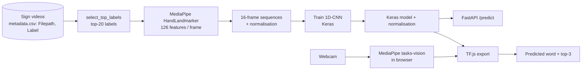

<div align="center">

# 🤟 SignModel — Real-time Sign Recognition from Hand Landmarks

**MediaPipe hand landmarks → lightweight 1D-CNN → in-browser (TensorFlow.js) or API inference, for 20 sign-language words.**


</div>

---

## 📌 Overview

SignModel recognises isolated sign-language words from a webcam stream. Instead of feeding raw video frames to a network, it extracts **21 3-D landmarks per hand with MediaPipe** (2 hands × 21 × 3 = **126 features per frame**), stacks **16 frames** into a sequence, and classifies it with a small **1D convolutional network**.

The trained model is exported twice so it can be used in two ways:

- **In the browser** — TensorFlow.js model served from `public/models/sign-cnn/` (no server round-trip, camera data stays on the device).
- **As an HTTP API** — a FastAPI service that accepts a `16 × 126` landmark sequence.

The web demo also includes **HandiBot**, a small reply endpoint that answers the recognised sign (OpenAI `gpt-3.5-turbo` when a key is set, otherwise a canned mock reply).

## 🧭 Workflow



## 🧠 Model

| Layer block | Configuration |
|---|---|
| Input | `(16, 126)` landmark sequence |
| Conv block 1 | Conv1D 64 (k = 3) → BatchNorm → MaxPool(2) → Dropout 0.2 |
| Conv block 2 | Conv1D 128 (k = 3) → BatchNorm → MaxPool(2) → Dropout 0.25 |
| Conv block 3 | Conv1D 128 (k = 3) → BatchNorm → GlobalAvgPool |
| Head | Dense 128 (ReLU) → Dropout 0.3 → Dense 20 (softmax) |
| Training | Adam (1e-3), sparse categorical cross-entropy, 30 epochs, batch 16, 80/20 train-test then 80/20 train-val (see `scripts/train_1dcnn_attempt2.py`) |

**Vocabulary (20 classes):** accident, bar, bed, before, bowling, call, candy, champion, change, check, cold, computer, cool, cousin, deaf, delay, drink, far, go, last.

## 🗂️ Data

The training videos and extracted landmark datasets are **not** in this repository.

> ⚠️ **Missing information.** The source and licence of the sign-language video dataset used for training are not documented here, and no evaluation accuracy is stored in the repository. Verify the dataset's licence before reusing or redistributing the data or the trained model; the MediaPipe `.task` files under `public/wasm/` are third-party assets distributed under their own licence.
<!-- CONFIRM: name/source and licence of the sign-video dataset used for training (metadata.csv with Filepath,Label). -->

## 📊 Results

The training script writes a `test_accuracy` and classification report to JSON, but **no evaluation results are stored in the repository**, so no accuracy figure is claimed here.
<!-- TODO(user): add test accuracy / per-class report / confusion matrix from your training run. -->

## 🔌 Inference API

```bash
pip install -r inference_api/requirements.txt
python -m uvicorn inference_api.app:app --host 0.0.0.0 --port 8000 --reload
```

`POST /predict` with `{"sequence": [[...126 floats...], ... 16 frames]}` returns:

```json
{ "label": "drink", "score": 0.94, "top3": [{ "label": "drink", "score": 0.94 }, ...] }
```

The API loads `artifacts/attempt2_cnn/cnn_model.keras`, `normalization.npz` and the label file (**not** committed — generate them with the training scripts or edit the paths at the top of `inference_api/app.py`). Swagger UI at `/docs`, health check at `GET /health`.

## 🚀 Run the Web Demo

```bash
npm install
npm run dev            # http://localhost:3000/demo/sign
```

Optional: set `OPENAI_API_KEY` in `.env.local` to enable LLM replies in HandiBot. Allow camera access in the browser.

## 🔁 Reproduce Training

```bash
# 1. keep the 20 most frequent labels
python scripts/select_top_labels.py metadata.csv metadata_top20.csv --top-n 20

# 2. extract landmarks in batches (repeat with --batch-index 0,1,2,…)
python scripts/extract_landmarks_attempt2_batch.py --csv metadata_top20.csv --data-root <videos> \
       --out-dir <batches_dir> --model public/wasm/hand_landmarker.task --frames 16 --batch-size 50 --batch-index 0

# 3. merge batches, 4. train, 5. export for TF.js
python scripts/merge_batches_attempt2.py --batches-dir <batches_dir> --out-file <merged.npz>
python scripts/train_1dcnn_attempt2.py --dataset <merged.npz> --labels <labels.json> --out-dir artifacts/attempt2_cnn
python scripts/export_tfjs_manual_attempt2.py --keras-model artifacts/attempt2_cnn/cnn_model.keras \
       --labels <labels.json> --norm artifacts/attempt2_cnn/normalization.npz --out-dir public/models/sign-cnn
```

> Flags are taken from each script's `argparse` definition. The extractor's default is `--frames 32` while the model expects 16 frames — pass `--frames 16` unless you resample later. <!-- CONFIRM: frames value actually used for the shipped model --> Some scripts also contain hard-coded local default paths (e.g. `--model`); pass your own.

## ✅ Verification Status

`npm install && npm run build` (Next.js 14) — **succeeds**. The training scripts and the FastAPI inference service were **not executed** (training videos and trained artifacts are not in the repository); the in-browser demo needs a webcam and was not exercised.

## 🧰 Tech Stack

| Role | Tools |
|---|---|
| Vision | MediaPipe HandLandmarker / `@mediapipe/tasks-vision` (WASM) |
| Deep learning | TensorFlow / Keras (training), TensorFlow.js (browser inference) |
| Backend | FastAPI, Uvicorn, Pydantic |
| Frontend | Next.js 14, React 18, TypeScript |

## 🔭 Limitations & Future Work

- 20 isolated words only; no continuous sign recognition or grammar.
- No published evaluation, no signer-independent split documented — report accuracy per signer and per class.
- Add a README-level demo GIF, model card and a landmark-normalisation description.
- Compare against a Transformer/GRU sequence model and larger vocabularies.

## 👤 Author

**Nour Ghribi** · [GitHub](https://github.com/Nour-Ghribi)
